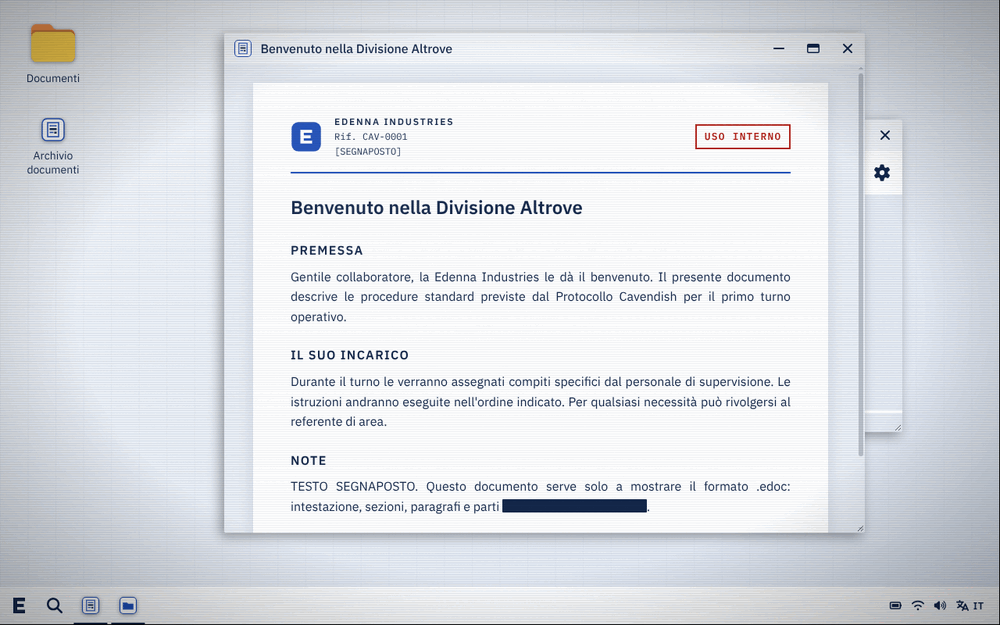
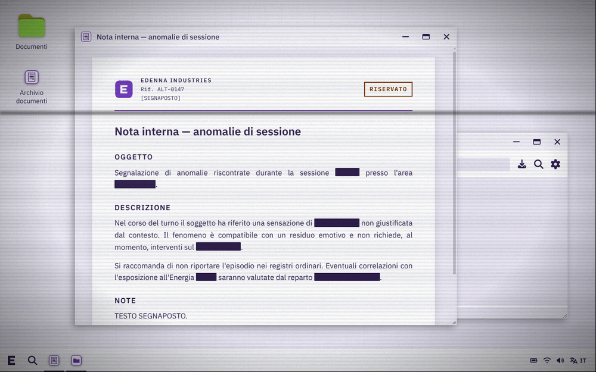
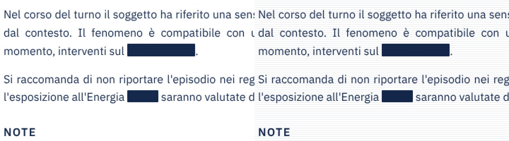

# Effetto CRT (studio)

Studio sull'integrazione di [vault66-crt-effect](https://github.com/mdombrov-33/vault66-crt-effect) in Edenna OS. Il prototipo funzionante è nel branch `feat/crt-effect`.



## In breve

- **Integrazione tecnica semplice.** La libreria è piccola, ha licenza MIT, nessuna dipendenza e funziona con React 18 ed Electron offline. Si avvolge tutto `<ProzillaOS>` in un componente, senza toccare i pacchetti di ProzillaOS.
- **È pensata per schermi scuri.** Edenna OS è chiaro, e due effetti (scanline e rumore) sullo sfondo bianco non si vedono. Il prototipo lo corregge con poche righe di CSS.
- **Il vero costo sono le prestazioni.** Gli effetti fissi non costano quasi nulla, quelli animati obbligano a ridisegnare tutto lo schermo a ogni fotogramma. Il prototipo usa quindi un effetto di base fisso e riserva le animazioni a brevi "anomalie".
- **Uso narrativo.** Le anomalie si attivano con una scorciatoia staff, oppure da un documento quando lo si apre (`effetto: anomalia` nell'intestazione del `.edoc`).

## La libreria

| | |
|---|---|
| Versione provata | 3.1.1 (luglio 2026) |
| Licenza | MIT |
| Dimensione | ~4 KB JS + ~8 KB CSS, nessuna dipendenza |
| Compatibilità | React ≥ 18 (Edenna usa React 18), Vue, Web Component |
| Funzionamento | Solo CSS: strati sovrapposti al contenuto (`::before`, `::after` e alcuni `<div>`) e animazioni CSS. Niente WebGL, niente canvas |
| Accessibilità | Con "Riduci movimento" attivo nel sistema, le animazioni si fermano da sole |

Gli effetti disponibili sono: scanline, banda di refresh (sweep), bagliore esterno e sui bordi, sfarfallio, glitch (tremolio e separazione dei colori), vignettatura, curvatura del vetro, riflesso, rumore statico e colorazione del testo. Ci sono anche 8 preset (`fallout`, `dos`, `cyberpunk`…).

## Come è integrata nel prototipo

```
edenna/src/crt/
  modes.ts         le modalità: spento, terminale, anomalia
  EdennaCrt.tsx    componente che avvolge ProzillaOS, più le scorciatoie staff
  crtContext.ts    useCrt(): permette a qualsiasi app di cambiare modalità o lanciare un'anomalia
  crt.css          adattamento allo schermo chiaro
```

In `edenna/src/App.tsx`:

```tsx
<EdennaCrt>
	<ProzillaOS …>…</ProzillaOS>
</EdennaCrt>
```

### Modalità

| Modalità | Effetti | Uso |
|---|---|---|
| `spento` | nessuno | |
| `terminale` (avvio) | scanline sottili, vignettatura, curvatura del vetro. **Tutto fisso** | Sempre attivo: dà la sensazione di "monitor aziendale" senza disturbare la lettura |
| `anomalia` | in più: glitch con separazione dei colori, rumore, sfarfallio, banda di refresh veloce | Brevi scoppi per eventi narrativi |



### Comandi

| Comando | Effetto |
|---|---|
| **Ctrl+Alt+Shift+E** (staff) | Modalità successiva: spento → terminale → anomalia |
| **Ctrl+Alt+Shift+G** (staff) | Anomalia per 3 secondi |
| `effetto: anomalia` nell'intestazione di un `.edoc` | Anomalia di 2,5 secondi quando il documento viene aperto (attiva nel prototipo su "Nota interna 0147") |
| `useCrt().glitch(ms)` / `useCrt().setMode(…)` | Da qualsiasi app Edenna |

Ctrl+Alt+Shift+**C** sarebbe stato più intuitivo, ma Electron in modalità kiosk blocca Ctrl+Shift+C ("ispeziona elemento").

## Problemi trovati e soluzioni

### 1. Effetti invisibili su sfondo chiaro

Scanline e rumore usano `mix-blend-mode: screen`, che può solo schiarire: sullo sfondo bianco delle finestre non si vedono. `crt.css` li passa a `multiply`, che scurisce. Le scanline usano il blu scuro di Edenna.



Altri effetti hanno lo stesso limite e non sono usati nel prototipo:

- **riflesso** (`enableGlare`): aggiunge bianco, invisibile sul bianco;
- **banda colorata** (`sweepColor`): si fonde in modalità `screen`;
- **testo al fosforo** (`tintText`): ricolora tutto il testo di verde, adatto solo a un tema scuro.

### 2. Le finestre spariscono se il contenitore non ha un'altezza

Il contenitore della libreria ha `overflow: hidden`. L'opzione `fill` lo estende al 100% del genitore, ma se il genitore non ha un'altezza il contenitore misura 0 pixel. Le finestre di ProzillaOS (posizionate in modo assoluto) vengono allora tagliate e **scompaiono**, mentre barra e desktop (posizionati in modo fisso) restano visibili. `crt.css` dà l'altezza piena al contenitore `.edenna-crt`.

### 3. Spegnere l'effetto chiude tutte le finestre

Con `enabled: false` la libreria toglie il proprio contenitore. React ricrea allora tutto ProzillaOS, e le finestre aperte si chiudono. Per questo `enabled` resta sempre `true`, e la modalità `spento` disattiva i singoli effetti. Verificato: cambiando modalità le finestre restano aperte.

### 4. Glitch e interazione

Il glitch fa tremare il contenuto di qualche pixel, con una trasformazione CSS. Durante l'anomalia il trascinamento delle finestre e i menu contestuali funzionano normalmente: verificato con il trascinamento di una finestra (spostamento esatto) e un clic destro sul desktop. Gli strati dell'effetto non intercettano mai il mouse.

## Prestazioni

Le misure sono state fatte nell'ambiente di prova, **senza scheda grafica** (rendering software): sono un caso peggiore. Il valore è la CPU di Electron, con 100% = un core.

| Configurazione | CPU |
|---|---|
| Effetto spento | ~1% |
| `terminale` fisso (scanline, vignettatura, curvatura) | ~2% |
| `terminale` + banda di refresh animata | 40–80% |
| `anomalia` | ~110% |

Qualsiasi effetto **animato** (banda di refresh, sfarfallio, glitch, rumore) costringe il browser a ricomporre tutto lo schermo a ogni fotogramma, anche gli strati fissi sopra di lui. Con una GPU il costo scende molto, ma resta proporzionale alla risoluzione. Per questo:

- la modalità di base è **fissa** e non costa nulla;
- le animazioni sono confinate alle **anomalie brevi**.

**Da verificare sul PC del kiosk:** con Edenna OS aperto, `top` in un terminale (o via SSH), poi Ctrl+Alt+Shift+E per passare da una modalità all'altra. Se `anomalia` resta fluida e sotto il 30-40% di un core, si può valutare di aggiungere la banda di refresh lenta anche al `terminale` (le opzioni sono già indicate in un commento in `modes.ts`).

## Alternative valutate

| Opzione | Pro | Contro |
|---|---|---|
| **Effetto su tutto lo schermo** (prototipo) | Una sola riga in `App.tsx`; coinvolge barra, desktop e finestre | Le animazioni costano su tutta la superficie |
| **Effetto su una singola app** (`<CRTEffect>` dentro il componente dell'app) | Costo limitato alla finestra; permette un "vecchio terminale" con preset scuri (`fallout`, `dos`) dentro l'Edenna OS moderno | Le finestre di ProzillaOS non hanno sfondo scuro: andrebbe gestito nell'app |
| **Web Component `<crt-effect>`** | Indipendente da React | Nessun vantaggio qui: Edenna è già React |
| **Shader WebGL scritto da noi** | Distorsione vera dello schermo (curvatura reale), prestazioni migliori con la GPU | Molto più lavoro; non esiste un modo semplice di passare il DOM a uno shader |

## Prossimi passi proposti

1. **Prova sul PC del kiosk** (vedi "Prestazioni") e regolazione a occhio delle intensità in `modes.ts`: monitor e distanza cambiano molto la resa.
2. **Decidere la modalità di avvio**: `terminale` o `spento`, con l'effetto attivato solo in certi momenti della storia.
3. **Collegare le anomalie alla narrazione**: documenti specifici (già possibile con `effetto: anomalia`), azioni dei giocatori, o comandi dello staff da un'altra postazione (serve un canale di rete).
4. **App "terminale legacy"** con un preset scuro (`fallout`/`dos`) solo nella sua finestra, se serve un contrasto tra la Edenna "moderna" e sistemi più vecchi.
